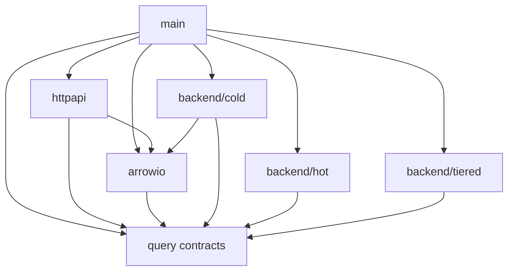
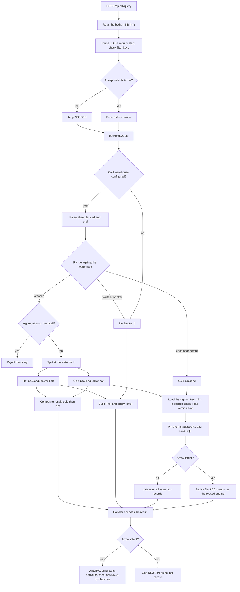

# Architecture

[Documentation index](README.md)

The Go module is `beehive-data-api`. The root entrypoint constructs dependencies
and routes; implementation lives in internal packages.

## Packages and dependencies

| Package | Responsibility |
| --- | --- |
| `internal/query` | Query and record types, backend/result interfaces, shared filter validation |
| `internal/arrowio` | Arrow schema, request intent, IPC encoding and compression |
| `internal/backend/hot` | Influx/Flux query generation and record conversion |
| `internal/backend/cold` | Iceberg SQL, native DuckDB execution, JSON scanning, Pelican signing and profiles |
| `internal/backend/tiered` | Watermark routing and composition of disjoint time ranges |
| `internal/httpapi` | Query parsing, response negotiation, HTTP/SSE handlers and metrics |
| `internal/testutil` | In-memory fixtures imported only by tests |

The shared query package has no Arrow or database dependencies. Arrow encoding
uses query contracts and imports no backend. The tiered backend uses query
contracts and imports neither concrete store. Cold storage uses Arrow helpers
without importing the HTTP handler in production; its integration tests can
exercise the real HTTP handler.

## Request execution

A submitted query is parsed, routed by the configured backend, and then written
as NDJSON or Arrow. Arrow intent is recorded before `backend.Query`, so the
cold backend can choose its native stream. The handler closes the returned
result.

The query handler validates the JSON request and records Arrow intent in the
request context when `Accept` selects Arrow. It calls the configured backend
before choosing the response writer. Hot-only operation uses Influx directly;
setting a cold warehouse wraps both stores in the tiered router.

The router sends ranges ending at or before the watermark to cold storage,
and ranges starting at or after it to hot storage. Ordinary crossing requests
are split at the exact nanosecond boundary, with cold results emitted first.
Crossing head/tail and aggregation requests are rejected rather than combined
with incorrect per-series semantics. The router trusts configured coverage;
it is not an archive reconciler.

The hot backend generates Flux, reads records through the Influx SDK, and
extracts measurement values and tags. The HTTP encoder converts those records
to NDJSON or batches of up to 65,536 rows for Arrow. Hot iteration order comes
from Flux, including its table grouping.

## Cold execution

Each cold request loads its signing key, mints a scoped read token and reads
`version-hint.text`. The resulting metadata-file URL is pinned for that
request. DuckDB reads Iceberg manifests and selected Parquet objects directly;
there is no API-side file-list cache or catalog registration step.

Both formats use the same SQL source predicates, absolute half-open time bounds
and optional head/tail logic. NDJSON uses a database/sql projection and scanner;
Arrow uses the native DuckDB streaming API and returns Arrow batches directly.
The public projection serializes the stored value to JSON text. Ordinary
metadata projection uses checked JSON fast paths with a general fallback;
head/tail retain a merged MAP for per-series partitioning.

The backend holds its lock until results close, so both formats share a
serialized cold resource budget and cannot replace each other's database-wide
scoped secret mid-query. The native Arrow database is initialized lazily and
reused. Connections, results and scoped request setup remain request-owned.

Native streaming avoids retaining a fully materialized result outside the
managed query path. It does not remove blocking scan, projection and sort
work. Queries execute over the whole range with an explicit final timestamp
sort; large requests may spill before their first batch. No chronological
execution-window or uniform-metadata discovery path remains.

## Result ownership

`query.Backend.Query` returns `query.Results` with `Next`, `Record`, `Err` and
`Close`. The HTTP handler closes the returned result. Ordinary hot/NDJSON
results are iterated row by row. Native cold results additionally expose an
Arrow reader through a structural interface recognized by the encoder.

Tiered results implement `query.CompositeResults.Parts()` to expose ordered
child streams without revealing their concrete result type. The encoder stops
on a child error and does not close children itself. Closing the enclosing
tiered result releases both children; opening hot unsuccessfully also closes
the already-open cold result.

`arrowio.WriteReader` borrows the supplied record reader and writes batches
using the public schema; the caller retains responsibility for releasing the
reader. Schema adoption can reuse column buffers with reference counting.
The native cold reader releases its connection/result resources before the
backend lock is released. Cancellation and error paths follow the same
ownership boundaries.

## Cold storage contract

The current reader targets Iceberg v3 observations with:

- `time` stored as `TIMESTAMPTZ_NS`, preserving nanosecond instants;
- `name` as the measurement name and one `value VARIANT` column;
- `meta MAP(VARCHAR, VARCHAR)` for metadata;
- promoted tag columns `plugin`, `vsn`, `node`, `host`, `task`, `job`, and `zone`.

Promoted tags are merged into public metadata with the existing collision
precedence. Stored types are projected into the same HTTP schema as hot
storage. NDJSON values retain raw JSON text internally instead of decoding
large integers through float64. Arrow exposes JSON strings, not storage MAP
or VARIANT arrays.

For the deployed URL layout, the warehouse base is
`https://<host>/sage/<isolated-prefix>/warehouse`. The API reads
`<base>/sage/obs/metadata/version-hint.text`, validates the metadata stem and
opens `<base>/sage/obs/metadata/<stem>.metadata.json`. Referenced metadata,
manifests and data objects must remain accessible. The API is a reader; it
does not publish snapshots or write warehouse files.

The adopted writer policy uses day partitions, chronological file batches of
at most 10 million rows, rows sorted by plugin then vsn then time within a
file, and plugin-pure row groups capped at 262,144 rows. Large plugins span
multiple groups; small plugins can share files. This is warehouse writer
policy, not a geometry constraint validated by the API on each request.
